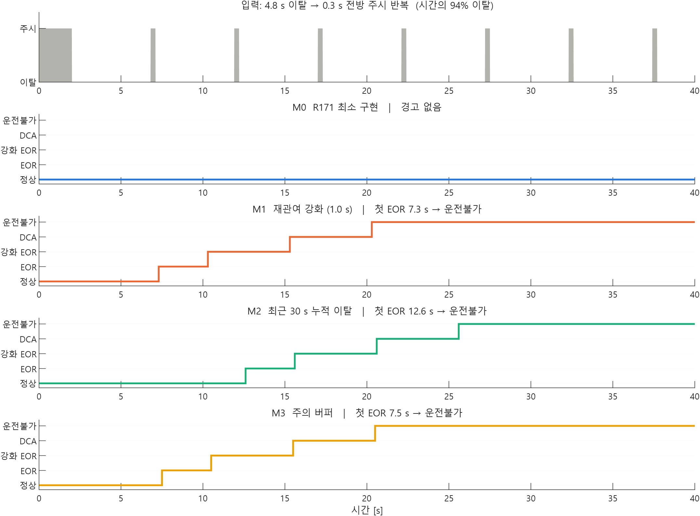

# 반복적 단기 시선이탈에 강건한 UN R171 Driver Engagement Supervisor

UN R171(DCAS)의 운전자 주시 감시를 조문 그대로 구현하면, **4.8초 이탈 / 0.3초 주시를 반복하는 운전자는 시간의 94%를 전방을 보지 않아도 경고를 받지 않습니다.** 이 저장소는 그 허점을 막는 감지 모델 M0~M3를 비교하고, 선택한 모델을 Raspberry Pi 5에서 10 ms 주기로 실행하는 Supervisor 코드입니다.



- 경고 단계(정상 → EOR → 강화 EOR → DCA → 운전불가)는 모든 모델이 공유하고, 이탈 감지 방식만 다릅니다.
- 어떤 모델도 R171보다 늦게 경고하지 않습니다. 모든 모델이 R171 기본 타이머를 함께 돌리고 자기 판정과 OR 합니다.
- 최종 모델 권고안은 M3입니다: [docs/model_selection.md](docs/model_selection.md)

## 저장소 구성: PC 코드와 Pi 코드

| 구분 | 위치 | 필요한 것 | 내용 |
|---|---|---|---|
| **PC에서 돌리는 코드** | `src/`, `model/`, `tests/`, 루트의 `*.m` | MATLAB R2026b | 기준 구현, Simulink/Stateflow 모델 생성, C 코드 생성, 검증, 평가, 그림 |
| **Pi에 올리는 코드** | [`deploy/`](deploy/) | gcc, make | 생성된 C 코드, 실행 프로그램 `des_main`, 데모 CSV. MATLAB 불필요 |

`deploy/` 폴더만 Pi로 복사하면 됩니다. 방법은 [deploy/README.md](deploy/README.md)에 있습니다.

**PC (MATLAB)**
```matlab
runtests('tests')        % 단위 테스트
run_r171_boundary        % R171 경계값 12케이스
make_figures             % 발표 그림 -> figures/
build_system(3)          % 모델 + C 코드 다시 생성 -> deploy/codegen/ (Simulink, Stateflow, Simulink Coder 필요)
```

**Pi 또는 Linux**
```bash
cd deploy/rpi
make
./des_main --csv ../demo/3_evasion.csv --calib 5    # M0는 조용하고 M3는 10.51초에 EOR
```

이 저장소에는 Supervisor만 있습니다. DMS 모듈, 실촬영 DMS 결과(`../dms_results`), 정상 운전 시선 생성기(`../supervisor_b`)는 들어 있지 않으므로, 이를 읽는 `run_dms_results`(기본 경로), `make_dms_figures`, `run_real_vs_synth`, `run_operating_point`는 해당 자료가 있어야 실행됩니다. `run_dms_results('deploy/demo')`는 저장소만으로 실행됩니다.

Stateflow 설계는 [docs/stateflow_design.md](docs/stateflow_design.md).

## 시스템 구조

```
DMS (노트북) ── CSV: timestamp, face_detected, yaw, pitch ──► RPi5 des_main --csv (10 ms 주기)
  ZOH 리샘플 + 통신 끊김(0.2 s) → valid=0
  [InputStage] 주시 영역 판정 + 고정(사진) 탐지
     ├─► [Ch_M0]  Detector(M0) ─ disengaged ─► Escalation (Stateflow) ─► esc_m0
     └─► [Ch_M3]  Detector(M3) ─ disengaged ─► Escalation (Stateflow) ─► esc_sel
  출력: 터미널 대시보드, 로그 CSV, (선택) GPIO LED·부저
```

**흐름:** MATLAB 기준 코드(`src/`) → `build_model.m`으로 `.slx` 자동 생성 → Simulink Coder(grt)로 C 생성 → Pi에서 gcc 빌드.
**검증:** 기준 코드 ↔ Simulink ↔ C 코드를 back-to-back으로 매 스텝 대조합니다. Pi 배포 방법은 [deploy/README.md](deploy/README.md)에 있습니다.

## 파일

| 파일 | 내용 |
|---|---|
| `src/des_params.m` | 모든 파라미터 (모델 선택, 입력 단계 포함) |
| `src/des_init.m` / `src/des_step.m` | 상태 초기화 / 1 스텝 (감지 계층 + 공통 Escalation). `%#codegen` |
| `src/des_detect.m` | 감지 계층 1 스텝 (des_step에서 분리. Simulink Detector 블록이 호출) |
| `src/des_input_init.m` / `src/des_input_step.m` | 입력 단계: 주시 영역 판정, 고정 탐지 |
| `src/des_resample.m` | DMS 프레임 → 100 Hz (ZOH, 통신 끊김 처리) |
| `src/sim_system.m` | 시스템 전체 기준 동작 (입력 단계 → M0 + 선택 모델) |
| `src/sim_des.m` | 시선 시퀀스 → 로그 (감지·Escalation만) |
| `src/gaze_pattern.m` | 이탈 x초 / 주시 y초 반복 패턴 생성 |
| `src/des_metrics.m` | EOR 횟수, 첫 EOR 시각, 최고 단계, 경고 없이 안 본 비율 |
| `src/b2b_scenarios.m`, `src/b2b_compare.m` | back-to-back 시나리오 / 매 스텝 비교 |
| `model/build_model.m` | Simulink/Stateflow 모델 자동 생성 → `model/des_supervisor.slx` |
| `model/sim_model.m` | Simulink 모델 시뮬레이션 (sim_system과 같은 형식) |
| `build_system.m` | 모델 생성 + C 코드 생성 → `deploy/codegen/` |
| `run_b2b.m` | back-to-back: 기준 코드 vs Simulink |
| `run_b2b_c.m` | back-to-back: 기준 코드 vs C 실행 프로그램 (노트북 빌드 또는 Pi 로그) |
| `deploy/` | Pi 배포 묶음 (생성 코드, `des_main.c`, Makefile, UDP 테스트 송신기) |
| `src/dms_load_csv.m` | DMS CSV 읽기 (`valid` 또는 `face_detected` 형식) + 처음 N초 0점 보정 |
| `run_dms_results.m` | DMS 팀 실촬영 CSV(`../dms_results`)를 시스템 전체에 넣어 M0~M3 결과 표. C 로그와 매 스텝 비교도 가능 |
| `run_demo_evasion.m` | 4.8/0.3 회피 패턴 M0~M3 비교 그림 |
| `run_evasion_grid.m` | 이탈×복귀 격자 탐지 지도 |
| `run_r171_boundary.m` | R171 경계값 12케이스 표 → `docs/r171_boundary.md` |
| `run_random_check.m` | 무작위 시퀀스에서 M1~M3가 M0보다 늦게 경고하지 않는지 매 스텝 확인 |
| `run_operating_point.m` | 파라미터별 탐지율-오경보 (supervisor_b 정상 운전 생성기 사용) |
| `run_adaptive_limit.m` | 적응형 회피 한계: 경고 없이 가능한 최대 이탈 비율 → `figures/fig4_adaptive_limit.png` |
| `run_real_vs_synth.m` | 실촬영 정상 주행과 합성 정상 운전의 시선 통계 비교 → `docs/real_vs_synth.md` |
| `make_dms_figures.m` | DMS 실촬영 CSV별 타임라인 그림(각도, 주시 판정, M0~M3 단계) → `figures/dms/` |
| `docs/model_selection.md` | 최종 모델 선택 근거 (권고안 M3) |
| `make_figures.m` | 발표 그림 → `figures/` (중간발표 버전은 `figures/midterm_1013/`) |
| `tests/` | 단위 테스트 (`runtests('tests')`) |

## 모델

| | 이탈 판정 (escalation 입력) | 해제 |
|---|---|---|
| M0 | 이탈 타이머 ≥ 5 s, 0.2 s 주시 시 리셋 | 0.2 s 주시 |
| M1 | 위와 같으나 리셋에 1.0 s 주시 필요 | 1.0 s 주시 |
| M2 | R171 타이머 **OR** 최근 30 s 중 누적 이탈 ≥ 10 s (Euro NCAP v1.2 §1.2.2 VATS) | 1.0 s 연속 주시 (윈도우 초기화) |
| M3 | R171 타이머 **OR** 주의 버퍼(최대 5 s) = 0 | 버퍼 ≥ 1.0 s 회복 |

모든 모델이 R171 기본 타이머를 갖고 OR 하므로, 연속 이탈에서 R171보다 늦게 경고하는 일은 구조적으로 없음.

**R171 01 series 공통 규칙 (모든 모델):**
- 재EOR (5.5.4.2.6.2.2): EOR 해제(재관여) 후 2초 안에 이탈이 시작되고 1초 지속되면 즉시 EOR (`reeor_*`).
- 경고 단계: 이탈 시작부터 EOR 5 → 강화 EOR 8 → DCA 13 → 운전불가 18초. 모두 규정 상한(5.5.4.2.6.2.3, 5.5.4.2.6.3.1, 5.5.4.2.6.4.1)이다.
- M0는 정량 조항만 구현한 기준선이다. 짧은 이탈 반복 대응(5.5.4.2.5.3)이 없으므로 R171을 다 만족하지는 않는다.

## 기본 파라미터로 확인된 동작 (100 Hz)

| 시나리오 | M0 | M1 | M2 | M3 |
|---|---|---|---|---|
| 4.8 s 이탈 / 0.3 s 주시 반복 (60 s) | **경고 없음** | 7.3 s 첫 EOR | 12.6 s | 7.5 s |
| 2 s 주시 후 연속 이탈 | 7.00 s | 7.00 s | 7.00 s | 7.00 s |
| 1.5 s 이탈 / 4 s 주시 (정상 근사, 120 s) | 경고 없음 | 없음 | 없음 | 없음 |
| 격자 220셀 (이탈 1~6 s × 주시 0.1~2 s) 탐지 | 68 | 132 | 220 | 203 |

회피 패턴에서 M1~M3는 결국 Driver Unavailable까지 올라감.

## 입력 단계 (`aoi_*`는 팀 확정값, `fz_*`는 임시값)

| 파라미터 | 값 | 의미 |
|---|---|---|
| `aoi_yaw`, `aoi_pitch` | 11°, 13° | 처음 5초 0점 보정 후 \|yaw\|, \|pitch\|가 이 범위 안이면 주시 (11/12 확정) |
| `in_stale` | 0.2 s | 이보다 오래된 프레임은 미검출 처리 |
| `fz_W`, `fz_range` | 10 s, 1.0° | 10초 동안 yaw와 pitch 변화폭이 모두 1° 미만이면 고정(사진 의심) → 미검출 처리 |
| `fz_enable` | M0만 false | M0는 R171 그대로 두고 비교 기준선으로 씀 |

## 검증 결과 (2026-11-12, R171 01 series 반영 후)

| 비교 | 시나리오 | 스텝 | 결과 |
|---|---|---|---|
| 기준 코드 vs Simulink/Stateflow (`run_b2b`) | 33 | 408,237 | 모두 일치 |
| 기준 코드 vs C, Windows MSVC 빌드 (`run_b2b_c`) | 34 | 415,233 | 모두 일치 |
| 기준 코드 vs C, Linux gcc 11.4 빌드 (WSL, `run_b2b_c('pi')`) | 34 | 415,233 | 모두 일치 (11/16) |
| 기준 코드 vs C (WSL gcc), DMS 실촬영 CSV (`run_dms_results([], 5, 'build/dms_c15')`) | 15 | - | 모두 일치 (11/16) |

**R171 경계값 12케이스** (`run_r171_boundary` → [docs/r171_boundary.md](docs/r171_boundary.md)): 12/12 통과. M0가 각 조항의 기대 시각과 정확히 같고, M1~M3는 어느 케이스에서도 M0보다 늦지 않다.

**무작위 시퀀스 검증** (`run_random_check(5000, 60)`, 11/16): 경계 근처 길이를 섞은 이탈/주시/미검출/운전자 응답 시퀀스 5000개(모델당 3,000만 스텝, M0 EOR 21,344회). M1~M3 모두 매 스텝 (a) M0가 이탈이면 자기도 이탈, (b) 경고 단계 ≥ M0, (c) M0가 EOR에 들어가는 순간 EOR 이상 — 위반 0.

**동작점** (`run_operating_point(m)` → `run_operating_point('plot')` → `figures/operating_point.png`): 모델별 핵심 파라미터를 훑어 격자 탐지율과 정상 운전(supervisor_b 생성기) 오경보를 비교.

- **시나리오 구성:** 경계값(0.19/0.20초 주시, 4.99/5.00초 이탈), 단계별 해제, DCA 응답, 운전불가 후 리셋, 미검출, 고정(사진), 무작위 10개, 불규칙한 30fps 입력과 프레임 끊김.
- **전이 우선순위 경계(tie sweep):** "해제"와 "다음 단계 시간 경과"가 같은 스텝에 겹치는 경우를 1 tick 단위로 훑습니다.
- **검증 민감도 확인:** Stateflow 차트에 일부러 오류를 넣으면 검증이 실패하는지 확인했습니다. 1 tick 시간 오류와 전이 우선순위 뒤바뀜 4가지를 모두 잡아냈습니다.
