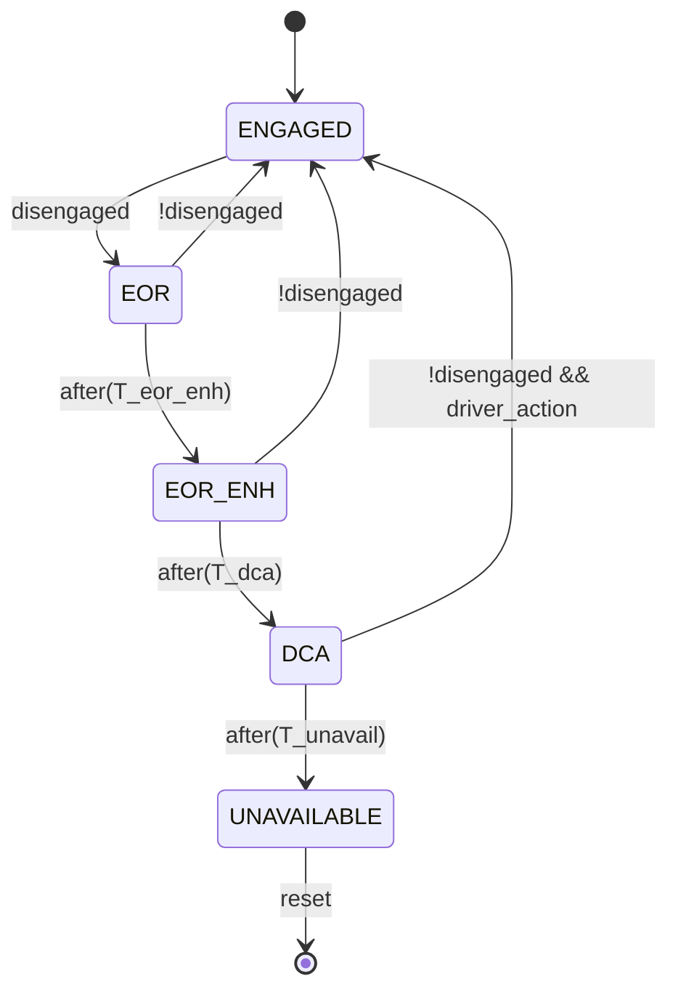
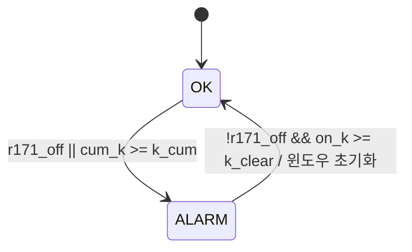
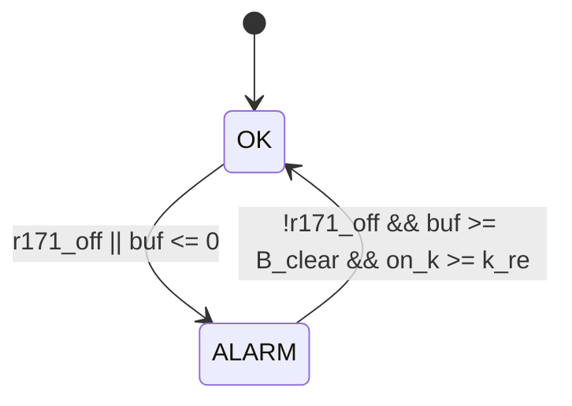

# Stateflow 설계 (des_step.m 과 1:1 대응)

MATLAB 기준 구현(`src/des_step.m`)을 golden model로 두고, Stateflow 차트를 같은 입력에 돌려
출력(`esc`)이 매 스텝 일치하는지 back-to-back으로 확인한다.

## 블록 구성 (Simulink, fixed-step discrete, Ts = 0.01 s)

```
gaze_on ─┐
gaze_valid ┼─► [Detector (모델별)] ── disengaged ──► [Escalation Chart (공통)] ──► esc
         │                                   driver_action ─┘   reset ─┘
```

- **Detector**: 모델마다 하나씩 (M0~M3). 출력은 `disengaged` boolean 하나.
  - 카운터/버퍼 위주라 MATLAB Function 블록(= `des_step` 1절·2절 그대로)이 가장 간단.
    Stateflow로 그리려면 아래 M2/M3 차트처럼 2-state(래치) + during 액션으로 표현.
- **Escalation Chart**: 공통 Stateflow 차트 하나. 모든 모델이 같은 차트를 씀.

## 1. Escalation Chart (공통)



| 구현 메모 | |
|---|---|
| 시간 조건 | `after(N, tick)` 사용, N = round(T/Ts). `sec` 대신 tick → 경계값에서 결정적 |
| 전이 우선순위 | 해제(`!disengaged`) 전이를 1순위, `after` 전이를 2순위 (des_step과 동일) |
| reset | 차트 최상위에 `reset` 이벤트/조건 → 전체 초기화 (des_init) |
| 출력 | 각 state의 entry에서 `esc = 0..4` |

## 2. Detector 공통부: R171 기본 타이머

모든 모델이 이 타이머를 가진다 (`r171_off`). M2/M3는 이걸 자기 판정과 OR 해서
"연속 이탈에 대해 R171보다 늦게 경고하지 않음"을 구조적으로 보장.

```
매 스텝:
  if on:   on_k++ ; if on_k >= k_re: dis_k = 0
           elif count_glance_time and dis_k > 0: dis_k++
  else:    on_k = 0 ; dis_k++
  r171_off = dis_k >= k_eor           (k_eor = 500, k_re = 20 / M1은 100)
```

## 3. M2 (누적 이탈) — 래치 차트


- during(공통): 원형 버퍼 갱신 `cum_k += (~on) - hist[idx]`
- `disengaged = in(ALARM)`

## 4. M3 (주의 버퍼) — 래치 차트


- during(공통): `on && on_k > k_lat ? buf += r_rec*Ts : (!on ? buf -= r_dec*Ts : -)`, [0, B_max] 클램프
- `B_max <= T_eor` 이면 연속 이탈 시 버퍼만으로도 5 s 안에 0 → OR가 없어도 하한 만족

## 5. 확정 필요한 설계 결정

| 항목 | 현재 | 비고 |
|---|---|---|
| Escalation 단계 시간 | 3 / 5 / 5 s (EOR 후 강화 / 강화 후 DCA / DCA 후 운전불가) | 확정 (11/12, R171 01 series 상한) |
| 짧은 주시(<200 ms) 중 타이머 | 정지 (`count_glance_time=false`) | 확정 (11/21, 팀). 근거와 한계는 `model_selection.md` "R171 해석" 절 |
| DCA 해제 조건 | 재관여 + driver_action | 확정 (11/18, R171 5.5.4.2.3.3.2 최소 요건보다 엄격) |
| gaze_valid=false | 이탈로 간주 | 얼굴 미검출 = 확인 불가 |
